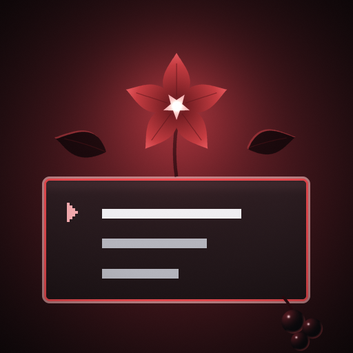

<p align="center">
  
</p>

<h1 align="center">Dulcamara</h1>

<p align="center">
  <strong>Dulcamara, a Nightshade app: RPG Maker 2000 and 2003 games on PS5 homebrew, by Oliv3rmoon. EasyRPG Player in Nightshade's black and red, made for the controller, updated from its own releases.</strong>
</p>

<p align="center">
  <a href="https://github.com/Oliv3rmoon/Dulcamara/releases/latest"></a>
  <a href="https://discord.gg/pSqgRU3YP9"></a>
  <a href="https://buymeacoffee.com/oliv3rmoon"></a>
  <a href="LICENSE"></a>
</p>

Dulcamara, a Nightshade app named after *Solanum dulcamara*, the bittersweet nightshade, is a PS5
homebrew app that runs games made with RPG Maker 2000 and RPG Maker 2003: story games and RPGs. It
plays them on [EasyRPG Player](https://easyrpg.org), the free reimplementation of those engines, built
into the app as a libretro core, and it is built on [Mandrake (formerly Nightshade Station)](https://github.com/Oliv3rmoon/Mandrake),
so it shares its frontend: the Vulkan screen with its CRT shaders, the black-and-red look of
[Nightshade](https://github.com/Oliv3rmoon/Nightshade) and the updates from its own releases. It is the
first step of a Nightshade answer to JoiPlay; more engines can join EasyRPG in the same app. The current
version is **0.1.0**; what changed is in the [changelog](docs/CHANGELOG.md).

## What you get

- **RPG Maker 2000 and 2003 games.** Everything EasyRPG Player runs, from its pinned source: the original
  engines' events, battles, pictures and sound (MIDI through EasyRPG's own synthesiser, WAV, Ogg Vorbis
  and MP3), and the Maniac Patch and EasyRPG extensions it supports. Japanese, Korean, Chinese, Cyrillic
  and Western games read their text in their own encoding.
- **A library that finds your games.** Copy a game's folder (or a `.zip` / `.easyrpg` of it) and it shows
  up with its title from `RPG_RT.ini` and its own title screen as the cover. Sort by title or by the last
  played; Square looks for new games without restarting.
- **Made for the controller.** Cross confirms, Circle cancels, Triangle opens the game's menu, and every
  button can be mapped again in Settings. The touchpad opens Dulcamara's menu at any time.
- **Fast-forward.** Hold R2 (or press it once, if you prefer) to run the game x2 to x8, for grinding and
  for long cutscenes.
- **CRT and LCD shaders.** CRT Royale, CRT Lottes, CRT Pi, Newpixie, Hyllian NTSC, Mattias, NTSC
  signals, LCD3x, zfast LCD and Game Boy LCD, from Mandrake's Vulkan screen. Or sharp square
  pixels, whole-number scaling and the game's own shape.
- **Nothing to pay for.** No paid features, no ads, no account. Free software under the GPL.
- **Updates from its own releases.** It asks [Oliv3rmoon/Dulcamara](https://github.com/Oliv3rmoon/Dulcamara/releases)
  for a newer release and installs it, after checking `PPSA99010.zip` against the release's `SHA256SUMS`.
- **No games.** It ships none and downloads none: copy your own.

## Install

1. Download `PPSA99010.zip` from the [latest release](https://github.com/Oliv3rmoon/Dulcamara/releases/latest)
   and unzip it.
2. Copy its `PPSA99010` folder to `/data/homebrew/` on the PS5 over FTP, as you install the other
   Nightshade apps, and set its permissions to `777` (in FileZilla: right-click the folder, *File
   permissions*, `777`, recurse into subdirectories). Without them the PS5 says *"Can't start the game
   or app"*. Nightshade's **Settings > Apps** can install it for you instead.
3. Restart ShadowMountPlus (or the console). **Dulcamara** appears on the home screen.
4. Start it once: it makes its folders in `/data/dulcamara/` and shows an empty library that says
   where games go.

Its title ID, `PPSA99010`, is its own: it sits beside Mandrake and the other Nightshade apps.

Like Mandrake, it needs `/data` unlocked to look into its games folder: LegacyJB, etaHEN's
*Legacy CMD server* or the Lapy helper it carries all do it (see Mandrake's README,
[Unlocking /data](https://github.com/Oliv3rmoon/Mandrake#unlocking-data-so-swanstationps5-can-see-your-games)).

## Where games go

```text
/data/homebrew/PPSA99010/            the app
/data/dulcamara/
├── games/
│   ├── <Game>/                      one folder per game: RPG_RT.ldb, RPG_RT.lmt, RPG_RT.ini, Title/, ...
│   ├── <Series>/<Game>/             or one folder down
│   ├── <Game>.zip                   or a .zip of the game (the game at its root or in a folder inside it)
│   └── <Game>.easyrpg               or an .easyrpg (a .zip by another name)
├── rtp/2000/ and rtp/2003/          the RPG Maker run-time packages (RTP), for games that need them
├── settings.ini, played.txt
└── logs/dulcamara.log       send this with bug reports
```

- **A game is a folder that holds `RPG_RT.ldb` and `RPG_RT.lmt`**, in any case. Copy the whole folder,
  with its `Title`, `CharSet`, `Music` and other folders.
- **Saves stay in the game's own folder** (`Save01.lsd`...), as on a PC, so they move with the game. For
  a `.zip` or `.easyrpg`, EasyRPG keeps them in a `.save` folder beside the archive.
- **The RTP.** Many games use pictures and sounds from the RPG Maker run-time package instead of
  carrying them. If a game shows missing graphics or sounds, put the RTP's folders (`Backdrop`,
  `Battle`, `CharSet`...) in `rtp/2000` (RPG Maker 2000 games) or `rtp/2003` (2003 games). The free
  [EasyRPG RTP replacement](https://easyrpg.org/rtp-replacement/) works there too.
- Copy games over FTP: the app reads the folder each time it opens, and Square on the library looks again.

## Controls

| Button | In a game (EasyRPG Player's buttons, the defaults) |
| --- | --- |
| Cross | Decision (A) |
| Circle | Cancel (B) |
| Triangle | Cancel and the game's menu (X) |
| Square | Shift (Y) |
| D-pad, left stick | Move |
| L3, R3 | The 0 and 5 keys |
| OPTIONS | EasyRPG Player's own settings |
| R2 | Fast-forward (while held, or on and off) |
| Touchpad | Dulcamara's menu: resume, fast-forward, back to the title screen, settings, quit |

Every button but R2 and the touchpad can be mapped in **Settings > Controls**. On the library: Cross
plays, Triangle sorts, Square looks for new games, OPTIONS opens Settings.

## Settings

- **Picture:** the shader, smooth or sharp scaling, whole-number scaling, the game's shape or 16:9,
  upscaling (Scale2x, xBR) when no shader is on. Opened from a game, the game shows behind it.
- **Playing:** the fast-forward speed and how R2 works, the left stick, the game's volume, the FPS.
- **Controls:** each controller button's game button.
- **Library:** the order, the interface sounds.
- **System:** the update check, and closing the app.

## Updates

When it starts (and from **Settings > System > Check for updates now**) Dulcamara asks GitHub for
the newest release of [Oliv3rmoon/Dulcamara](https://github.com/Oliv3rmoon/Dulcamara/releases)
that is not a pre-release. When its tag is a newer version and it carries `PPSA99010.zip` and
`SHA256SUMS`, both this repository's own files, the ZIP is checked against `SHA256SUMS` and installed
into the folder the app runs from; the new version runs from the next start. Your games and saves are not
touched. A release built by this repository's workflow can be checked with
`gh attestation verify PPSA99010.zip -R Oliv3rmoon/Dulcamara`.

## Requests, bugs and support

- **Ask for a fix or a feature:** [open an issue](https://github.com/Oliv3rmoon/Dulcamara/issues/new/choose),
  or ask in **[nightly on Discord](https://discord.gg/pSqgRU3YP9)**.
- **Bugs:** open an issue with `/data/dulcamara/logs/dulcamara.log`, copied right after
  the problem, and which game it was. Never attach games or their files.
- **A game that doesn't run right:** check it on EasyRPG Player on a PC first; if it fails there too, the
  [EasyRPG Player issues](https://github.com/EasyRPG/Player/issues) are the place.
- **If my work helps you,** you can [buy me a coffee](https://buymeacoffee.com/oliv3rmoon).

## Building from source

The PS5 app builds on Linux or WSL (Ubuntu 24.04); GitHub Actions builds every push
([.github/workflows/build.yml](.github/workflows/build.yml)):

```bash
sudo apt install clang-18 lld-18 llvm-18 libclang-rt-18-dev make ninja-build ccache cmake pkg-config \
  python3 python3-venv tar unzip wget zip zstd
git clone --recurse-submodules https://github.com/Oliv3rmoon/Dulcamara.git
cd Dulcamara
make                            # -> dist/PPSA99010/ and dist/PPSA99010.zip
python3 tools/make_release.py   # optional: build, and pack PPSA99010.zip as a release has it
```

`make` builds EasyRPG Player's core (`tools/build-easyrpg.sh`: EasyRPG Player and liblcf from their
submodules, pixman from its release, the rest from the PacBrew prefix, all in one archive with the API
renamed `easyrpg_retro_*`), links the RADV Vulkan driver (`tools/fetch-radv.sh`), compiles `src/` and
signs `eboot.bin`.

The host checks need no PS5 SDK (cmake, a C/C++ compiler, and fmt, libpng, FreeType, HarfBuzz,
libvorbis, mpg123 and pixman from the system):

```bash
make host-checks   # the game detection (tests/test_library.py) and EasyRPG Player run headless
                   # on EasyRPG's TestGame (tests/test_core.py), fetched for the test only
make desktop       # the app in a window on this computer (SDL2), for working on the interface
```

| Path | What |
|---|---|
| `src/main.c` | start-up, the main loop, the game screen |
| `src/core/cores.h`, `cores.c` | the cores' table: each core's libretro functions and defaults |
| `src/core/host.c` | the libretro host: environment, picture, sound, buttons |
| `src/library.c`, `src/rpgmaker.c` | finding games, their titles, covers and engine |
| `src/covers.c` | the title screens, read on a background thread |
| `src/ui/` | the library, the in-game menu, Settings, and Mandrake's drawing, text and sounds |
| `src/platform/` | Mandrake's PS5 platform layer and Vulkan screen (with the CPU-frame upload for the shaders) |
| `tools/build-easyrpg.sh` | the core, for the PS5 or (`host`) for this computer |
| `tools/patches/liblcf-iconv.patch` | liblcf's encodings through iconv, without ICU |
| `tools/render-home-art.py` | the icon and the home-screen pictures |
| `docs/boilerplate/` | the PS5 app boilerplate everything is built on |

### Adding a core

A second core (ScummVM's libretro core is next) is a static archive built like EasyRPG's, with its API
renamed `<core>_retro_*`, and one entry in `src/core/cores.c`'s table; `src/core/cores.h` lists the steps.

## Thanks

- **[EasyRPG](https://easyrpg.org)**, the team behind EasyRPG Player and liblcf, who made RPG Maker 2000
  and 2003 games playable everywhere as free software. Dulcamara only puts their work on the PS5;
  how well a game runs is theirs to credit.
- **[Mandrake (formerly Nightshade Station)](https://github.com/Oliv3rmoon/Mandrake)** and the work it is made of:
  **[SwanStationPS5](https://github.com/darkxex/SwanStationPS5)** by **darkxex**, whose frontend this is,
  **[PSXS5](https://github.com/SynoPiia/PSXS5)** by **SynoPiia**, and **BlackBearReloaded**'s
  ps5-native-app-boilerplate.
- **[ps5-payload-dev](https://github.com/ps5-payload-dev)** for the SDK and PacBrew, **Mihawk-99** for the
  RADV port, and everyone in [THIRD_PARTY_NOTICES.md](THIRD_PARTY_NOTICES.md).

## Legal

Dulcamara is free software under the GNU General Public License, version 3 or later
([LICENSE](LICENSE)). EasyRPG Player is GPL-3.0-or-later and liblcf MIT; every component keeps its own
licence, listed in [THIRD_PARTY_NOTICES.md](THIRD_PARTY_NOTICES.md), and the app folder carries their
texts in `licenses/`. It is an unofficial project: neither the EasyRPG team, Enterbrain / Kadokawa nor
Sony endorse it. RPG Maker is a trademark of its owners. No game, RTP, key or system file is included or
downloaded: use games you have the right to play.
